<!-- ░░░ generated by build.py — edit CONFIG there, then re-run ░░░ -->
<div align="center">




<p>
  <a href="https://linkedin.com/in/anjankumarln"></a>
  <a href="https://instagram.com/akln_17"></a>
  <a href="mailto:anjankumarln120@gmail.com"></a>
  <a href="https://github.com/ALN-web"></a>
</p>

</div>

---

<table>
<tr>
<td width="52%" valign="top">

### `> cat about_me.json`

```json
{
  "name":      "Anjankumar LN",
  "roles":     ["Engineering Student", "Full-Stack Developer",
                "Open Source Enthusiast"],
  "building":  "Servora — AI-powered Customer Resolution System",
  "learning":  ["Advanced MERN", "AI Agents & LLM Apps",
                "Blockchain & Cybersecurity", "System Design",
                "Open Source Engineering"],
  "ask_me":    ["DSA", "JavaScript & TypeScript", "React & Node.js",
                "MongoDB & REST APIs", "Git & GitHub",
                "Hackathons & Open Source"],
  "fun_fact":  "hackathon idea → working prototype in a few days"
}
```

</td>
<td width="48%" align="center" valign="top">



<sub><i>my career, version-controlled. no force-pushes. (yet)</i></sub>

</td>
</tr>
</table>

---

## `🚀 > ps aux | grep building`

| PROCESS | STATUS | DESCRIPTION |
|:--|:--:|:--|
| **🤖 Servora** |  | An AI-powered Customer Resolution System that automates issue triaging, resolution workflows and customer support operations. |
| **🌍 Open Source** |  | Actively contributing to open-source projects and improving developer tools. |
| **🛠️ Learning by Building** |  | Creating full-stack applications and AI-powered products with modern tech. |

---

## `⚡ > ls ~/arsenal`

<table align="center">
<tr><td align="right"><code>LANGUAGES</code></td><td></td></tr>
<tr><td align="right"><code>FRONTEND</code></td><td></td></tr>
<tr><td align="right"><code>BACKEND</code></td><td></td></tr>
<tr><td align="right"><code>DATABASE</code></td><td></td></tr>
<tr><td align="right"><code>TOOLS</code></td><td></td></tr>
</table>

---

## `📡 > ./telemetry --live`

<div align="center">


</div>

---

## `🏆 > cat trophies.log`

<div align="center">

</div>

---

## `🎯 > cat goals_2026.todo`

```diff
+ [ ] Contribute consistently to Open Source
+ [ ] Build production-grade SaaS products
+ [ ] Get selected for GSoC
+ [ ] Master the MERN stack
+ [ ] Solve 500+ DSA problems
+ [ ] Ship AI-powered applications
- [x] Sleep 8 hours        // deprecated
```

---

<div align="center">

## `🐍 THE SNAKE IS EATING MY CONTRIBUTIONS`

<picture>
  <source media="(prefers-color-scheme: dark)" srcset="https://raw.githubusercontent.com/ALN-web/ALN-web/output/github-snake-dark.svg" />
  <source media="(prefers-color-scheme: light)" srcset="https://raw.githubusercontent.com/ALN-web/ALN-web/output/github-snake.svg" />
  
</picture>

<br/><br/>


</div>
